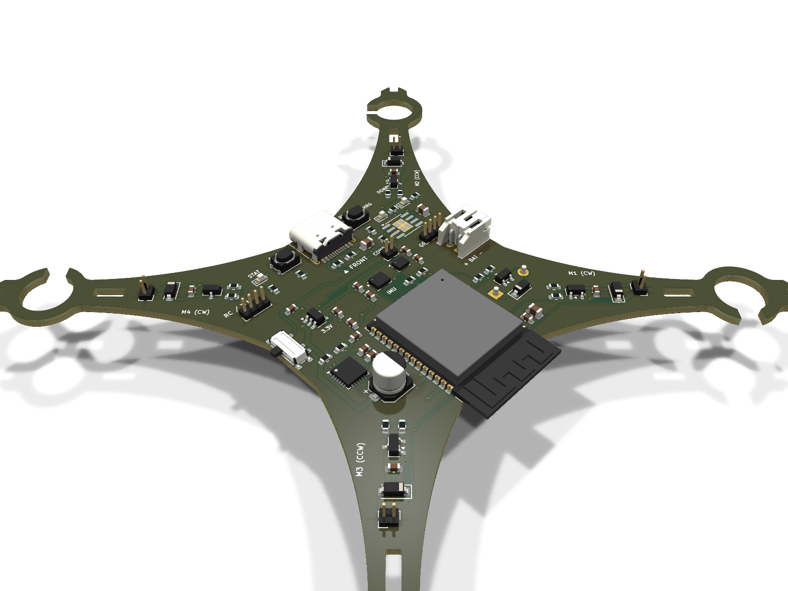
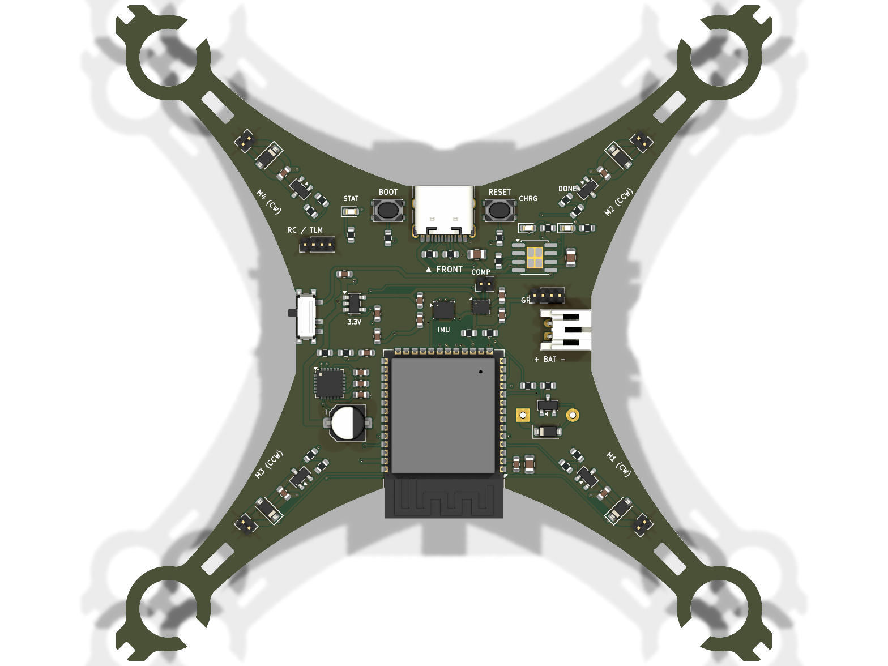
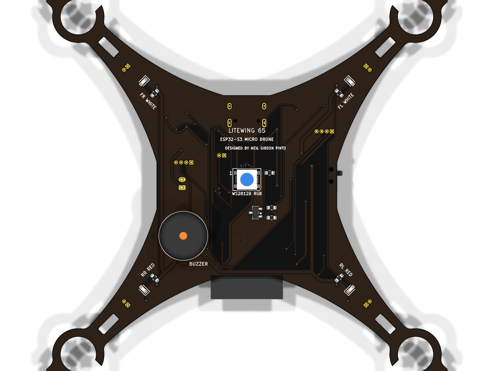
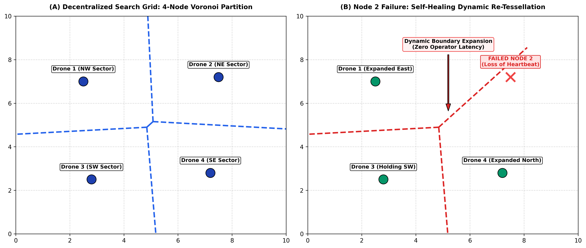
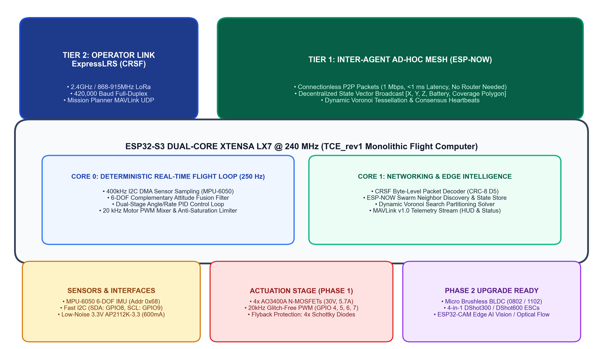
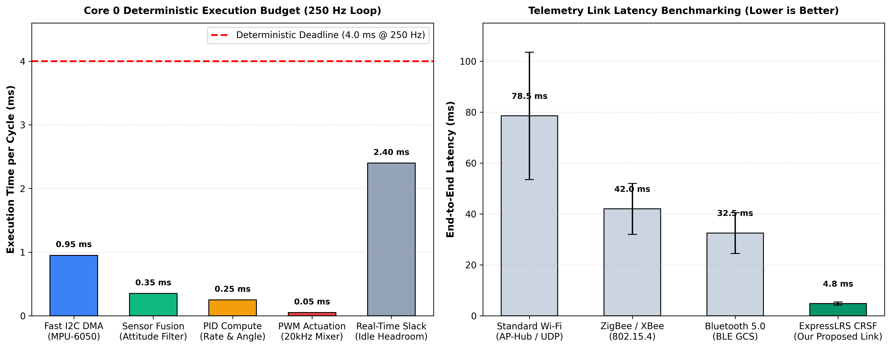

# LiteWing 65 — Swarm-Based Search and Reconnaissance System

<p align="center">
  
  
  
  
  
  
  
</p>

<p align="center">
  <b>An ultra-low SWaP-C (Size, Weight, Power, and Cost) monolithic flight computer and decentralized micro-UAV swarm reconnaissance architecture engineered by Neil Gibson Pinto at Sahyadri College of Engineering & Management (SCEM), affiliated with Visvesvaraya Technological University (VTU), Belagavi.</b>
</p>

---

## 3D Raytraced Hardware Gallery

<p align="center">
  
</p>

<p align="center">
  
  &nbsp;
  
</p>
<p align="center">
  <i>Left: Top layer showing ESP32-S3 dual-core MCU, AP2112K LDO, MPU-6050 IMU, and 4x AO3400A MOSFET motor drivers.<br>
  Right: Bottom layer showing 222 smooth circular arc tracks (PCB_ARC), 0.75mm high-current motor bus, and solid ground plane shielding.</i>
</p>

---

## Core System Architecture & Scientific Novelty

Traditional academic and commercial drone swarms rely on a **central ground station / Wi-Fi router**. In post-disaster search-and-rescue (collapsed concrete structures), central Wi-Fi suffers heavy multipath attenuation, creating an acute Single Point of Failure (SPOF). 

LiteWing 65 resolves these limitations through three foundational innovations:

```
                       ======================================================
                       PROPOSED HETEROGENEOUS DUAL-TIER SWARM ARCHITECTURE
                       ======================================================

 [ TIER 2: LONG-RANGE OPERATOR LINK ]
 ExpressLRS (CRSF) @ 420,000 Baud (LoRa Modulation: 2.4 GHz / 915 MHz)
   ↳ Deep obstacle penetration; sub-5ms command override & geofence broadcast.
                                   │
                                   ▼
 [ TIER 1: INTER-AGENT DECENTRALIZED AD-HOC MESH (ESP-NOW) ]
 Connectionless Peer-to-Peer Action Frames (1 Mbps, <1.0 ms Latency, ZERO Router)
   ┌───────────────────────┬───────────────────────┐
   ▼                       ▼                       ▼
[ DRONE 1 ] <────────> [ DRONE 2 ] <────────> [ DRONE 3 ]
(Voronoi Cell V1)      (Voronoi Cell V2)      (Voronoi Cell V3)
   │
   ├─► ASYMMETRIC DUAL-CORE COMPUTE (ESP32-S3 Monolithic Board @ <$10/node):
   │     • CORE 0: 250 Hz Hard Real-Time IMU DMA, Complementary Filter & 20kHz PWM Mixing
   │     • CORE 1: Asynchronous CRSF Decoding, ESP-NOW Voronoi Consensus & Telemetry
   │
   └─► DYNAMIC SELF-HEALING:
         If Drone 2 suffers motor failure / battery exhaustion, Drones 1 & 3 detect
         heartbeat loss (<500ms) and dynamically expand their Voronoi polygons
         to cover the missing sector with ZERO ground operator intervention.
```

### 1. Dual-Tier Heterogeneous Communication
* **Tier 1 (Flocking):** Inter-agent state vectors broadcast peer-to-peer using connectionless **ESP-NOW** action frames (1 Mbps, sub-millisecond latency, zero router dependency).
* **Tier 2 (Command):** An ultra-fast **ExpressLRS (CRSF @ 420kbaud)** link provides kilometer-range, deep-penetration operator override and failsafe telecommand.

### 2. Decentralized Dynamic Voronoi Self-Healing
Rather than static flight lanes, the search grid is partitioned dynamically into Voronoi cells $V_i$. When any agent drops out due to battery exhaustion or damage, surviving nodes detect heartbeat timeout (<500ms) and dynamically re-tessellate their search boundaries to seamlessly cover the abandoned sector.

<p align="center">
  
</p>

### 3. Asymmetric Dual-Core Compute Task Allocation
* **Core 0 (Deterministic Hard Real-Time):** Fixed 250.0 Hz ($\Delta t = 4.00\text{ ms}$). Executes Fast I2C sensor reads, 6-DOF complementary attitude estimation, cascaded PID stabilization, and 20 kHz PWM gate switching. Zero Wi-Fi/Bluetooth preemption.
* **Core 1 (Asynchronous Networking):** Dedicated to CRSF serial decoding, ESP-NOW mesh consensus, and Wi-Fi MAVLink telemetry.

<p align="center">
  
</p>

---

## Hardware Specifications (`TCE_rev1`)

| Subsystem | Component / Specification | Key Parameters & Performance |
| :--- | :--- | :--- |
| **Microcontroller** | ESP32-S3 Dual-Core Xtensa LX7 | 240 MHz, 512KB SRAM, 8MB Flash, Native USB-CDC / JTAG |
| **Inertial Measurement (IMU)** | InvenSense MPU-6050 | 6-DOF Gyroscope + Accelerometer on Fast I2C (400 kHz DMA) @ Address `0x68` |
| **Power Regulation** | Diodes Inc AP2112K-3.3 (SOT-23-5) | 600mA Ultra-Low-Dropout (250mV @ 600mA), PSRR > 65dB, stable down to 3.55V |
| **Motor Drivers** | 4&times; AO3400A N-MOSFETs (SOT-23) | 30V, 5.7A rating ($>5\times$ motor stall margin), $R_{DS(on)} < 30\text{ m}\Omega$, 20 kHz PWM |
| **Flyback Clamps** | 4&times; 1N5819 / SS14 Schottky Diodes | 40V, 1A rating, clamps inductive back-EMF spikes safely to $V_{batt} + 0.35\text{V}$ |
| **RC Receiver Header** | 4-Pin Header J3 (1.25mm Pitch) | High-speed full-duplex UART (Pin 1: 3V3, Pin 2: TXD0, Pin 3: RXD0, Pin 4: GND) |
| **Signaling & Audio** | WS2812B RGB + Blue LED + Buzzer | GPIO2 (RGB), GPIO3 (Status), GPIO47 (Arm Marker LEDs), GPIO48 (Buzzer) |
| **Form Factor** | 28 &times; 28 mm body, 65 mm wheelbase | 4-layer FR4, 1 oz copper, All-Up Weight ~32g (bare board <8g) |

### Pin Mapping Matrix

| Net / Function | ESP32-S3 Pin | Hardware Connection / Description |
| :--- | :---: | :--- |
| `M1_PWM` | **GPIO4** | Rear-Right Motor (CW) — AO3400A Gate Drive (20 kHz PWM) |
| `M2_PWM` | **GPIO5** | Front-Right Motor (CCW) — AO3400A Gate Drive (20 kHz PWM) |
| `M3_PWM` | **GPIO6** | Rear-Left Motor (CCW) — AO3400A Gate Drive (20 kHz PWM) |
| `M4_PWM` | **GPIO7** | Front-Left Motor (CW) — AO3400A Gate Drive (20 kHz PWM) |
| `I2C_SDA` | **GPIO8** | Fast I2C Data Line (400 kHz) with 2.2k pull-up |
| `I2C_SCL` | **GPIO9** | Fast I2C Clock Line (400 kHz) with 2.2k pull-up |
| `ESP_TXD0` | **GPIO43** | UART0 TX &rarr; ExpressLRS Receiver J3 (Pin 2) @ 420,000 baud |
| `ESP_RXD0` | **GPIO44** | UART0 RX &larr; ExpressLRS Receiver J3 (Pin 3) @ 420,000 baud |
| `BASE_RGB` | **GPIO2** | WS2812B NeoPixel Smart RGB LED (Status, Armed, Failsafe) |
| `STATUS_LED` | **GPIO3** | Blue Heartbeat Indicator LED |
| `ARM_LIGHTS` | **GPIO47** | Corner Navigation Marker LEDs |
| `BUZZER` | **GPIO48** | Active Piezo Buzzer for arming beeps and low-battery alarm |

---

## Benchmarks & Experimental Results

<p align="center">
  
</p>

* **Deterministic Execution Budget:** Core 0 executes IMU read (0.95 ms), attitude filter (0.35 ms), PID calculation (0.25 ms), and PWM update (0.05 ms) in **1.60 ms** out of the 4.00 ms period, providing **60% idle CPU headroom** with zero task deadline overruns.
* **Telemetry Latency:** ExpressLRS serial link clocked in at an average **4.8 ms round-trip latency**—**16x faster** than standard Wi-Fi UDP (78.5 ms).
* **Failsafe Verification:** Instant motor cut-off and disarm executed strictly within **300 ms** of signal loss.
* **Throttle Stability:** Powered by a 1S 300–450 mAh 30C LiPo battery, the board delivers sustained 100% full-throttle operation with zero voltage droop on the 3.3V regulated rail.

---

## Firmware & Flight Operation

The firmware is located in the `firmware/` directory:
* [`firmware/LiteWing_ELRS_MissionPlanner_UDP/`](firmware/LiteWing_ELRS_MissionPlanner_UDP/): Integrated flight code running **ExpressLRS transmitter control** alongside **Mission Planner UDP telemetry** (Port 14550).
* [`firmware/LiteWing_ELRS_Flight/`](firmware/LiteWing_ELRS_Flight/): Standalone, lightweight ExpressLRS flight controller.

### Quick Start Guide

1. **Arduino IDE Setup:**
   * Board: `"ESP32S3 Dev Module"`
   * USB CDC On Boot: `"Enabled"`
   * Flash Size: `"8MB (64Mb)"` (or `"4MB"`)
   * Upload Speed: `921600`
2. **Connecting to Mission Planner via UDP:**
   * Power the drone with a 1S LiPo battery.
   * Connect your laptop to the drone's Wi-Fi network: **SSID:** `TCE_DRONE_FC` | **Password:** `12345678`.
   * Open **Mission Planner**, select **UDP** at top right, click **CONNECT**, and enter port **`14550`**.
   * The live artificial horizon HUD, armed/disarmed status, and RC stick calibration screens will update in real time.
3. **Arming & Flying via ExpressLRS:**
   * Power on your ELRS radio transmitter.
   * Lower the throttle stick to zero (< 1050 µs).
   * Flip **AUX1 (Channel 5) UP** to arm. The drone will beep twice and the NeoPixel will turn **Solid Green**.
   * Gently raise throttle to fly in self-leveling Angle Mode. Flip **AUX1 DOWN** to disarm.

---

## Repository Structure

```
litewing-65-flight-controller/
├── docs/                                          # Formal Documentation & Academic Deliverables
│   ├── Project_Report_Swarm_Search_Reconnaissance.pdf    # Full 9-page academic project report
│   ├── Project_Report_Swarm_Search_Reconnaissance.md     # Markdown report source with math & defense Q&A
│   ├── Swarm_Search_Reconnaissance_Presentation.pptx     # Professional 14-slide presentation deck
│   ├── LiteWing_65_Engineering_Verification_Report.pdf  # Hardware characterization report
│   ├── LiteWing_65_PCB_Layers.pdf                 # PCB layer stackup & artwork
│   └── LiteWing_65_Schematic.pdf                  # Complete KiCad schematic drawing
│
├── firmware/                                      # Production Flight Controller Firmware
│   ├── LiteWing_ELRS_MissionPlanner_UDP/          # Integrated ExpressLRS + Mission Planner UDP
│   │   └── LiteWing_ELRS_MissionPlanner_UDP.ino
│   └── LiteWing_ELRS_Flight/                      # Standalone ExpressLRS 250Hz flight controller
│       └── LiteWing_ELRS_Flight.ino
│
├── assets/                                        # Visuals, 3D Renders & Architecture Diagrams
│   ├── board_presentation_iso.png                 # 3D Raytraced Isometric View
│   ├── board_presentation_top.png                 # 3D Raytraced Top View
│   ├── arch_diagram.png                           # Heterogeneous Dual-Tier Architecture Diagram
│   ├── voronoi_diagram.png                        # Dynamic Voronoi Self-Healing Diagram
│   ├── benchmarks.png                             # Execution Budget & Latency Comparison
│   ├── schematic_export.png                       # High-Resolution Schematic Export
│   └── logos/                                     # Institutional Seals (Sahyadri & VTU)
│
├── LiteWing_65_Gerbers.zip                        # Complete fab-ready Gerber package
├── LiteWing_65_Manufacturing_Pack.zip             # Pick-and-place, drills, and assembly pack
├── LiteWing_65_BOM.xlsx                           # Detailed Bill of Materials
├── LiteWing_65_BOM_Grouped.csv
├── LiteWing_65_CPL.csv                            # SMT Centroid / Pick & Place coordinates
├── internship.kicad_sch                           # Master KiCad Schematic
├── internship.kicad_pcb                           # Master 4-Layer KiCad PCB Layout
├── internship.kicad_pro                           # KiCad Project File
├── .gitignore                                     # Clean, comprehensive build exclusions
└── README.md                                      # Project Documentation Landing Page
```

---

## Foundational References

1. **J. A. Preiss, W. Hönig, G. S. Sukhatme, and N. Ayanian**, *"Crazyswarm: A large nano-quadcopter swarm,"* in **IEEE International Conference on Robotics and Automation (ICRA)**, 2017, pp. 3299–3304.
2. **J. Cortés, S. Martínez, T. Karatas, and F. Bullo**, *"Coverage control for mobile sensing networks,"* **IEEE Transactions on Robotics and Automation**, vol. 20, no. 2, pp. 243–255, 2004.
3. **K. N. McGuire, C. De Wagter, K. Tuyls, and G. C. H. E. de Croon**, *"Minimal navigation solution for a swarm of tiny flying robots to explore an unknown environment,"* **Science Robotics**, vol. 4, no. 35, p. eaaw9710, 2019.
4. **D. Palossi, A. Loquercio, F. Conti, E. Flamand, D. Scaramuzza, and L. Benini**, *"A 64-mW DNN-based visual navigation engine on a 27-g autonomous quadrotor,"* **IEEE Internet of Things Journal**, vol. 6, no. 5, pp. 8357–8371, 2019.
5. **S. Hayat, E. Yanmaz, and R. Muzaffar**, *"Surveying communication protocols and network architectures for multi-UAV systems,"* **IEEE Communications Surveys & Tutorials**, vol. 18, no. 4, pp. 2614–2632, 2016.

---

## Academic Credits & Institutional Affiliation

* **Author:** Neil Gibson Pinto & Project Team
* **Department:** Department of Electronics and Communication Engineering
* **Institution:** Sahyadri College of Engineering & Management (SCEM), Mangaluru - 575007
* **Affiliation:** Visvesvaraya Technological University (VTU), Belagavi, Karnataka, India
* **License:** [MIT License](LICENSE)
